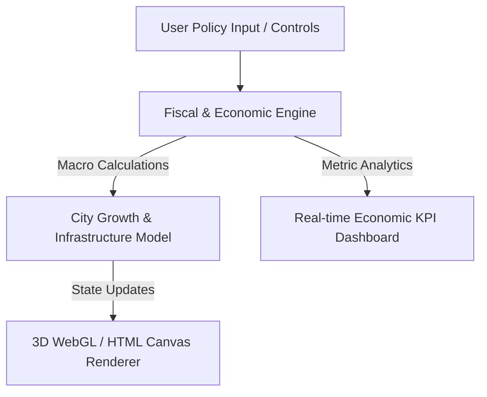

# Sovereign President: 3D Political & Economic City Simulator

A web-based 3D simulation framework exploring the systemic impacts of fiscal policy, human capital investments, and public urban zoning on macroeconomic metrics and infrastructure sustainability.

---

## 🏗️ System Architecture



---

## ⚙️ Setup & Deployment

### Local Development (No Build Step Required)
Since this project runs on vanilla HTML5/JS WebGL architecture, you can serve it via any static file server:

```bash
git clone [https://github.com/Dmitrizakanilov279/sovereign-president-simulator.git](https://github.com/Dmitrizakanilov279/sovereign-president-simulator.git)
cd sovereign-president-simulator

# Start a local web server using Python
python3 -m http.server 8000
```
Open browser at `http://localhost:8000`

---

## 📈 Economic Simulation Logic

* **Fiscal Policy:** Adjust tax rates vs. public infrastructure expenditure.
* **Urban Zoning:** Balance industrial density with environmental impact metrics.
* **Human Capital:** Model productivity growth relative to education and healthcare allocations.
