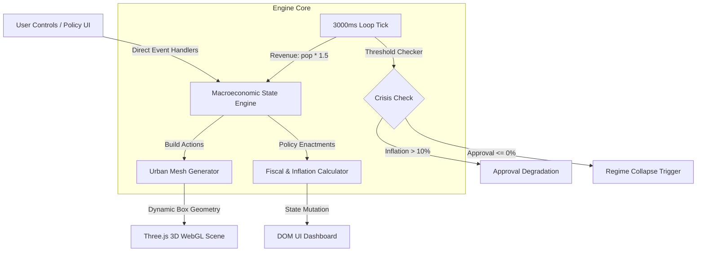

# SOVEREIGN V8.0 - 3D Political & Economic City Simulator

A zero-dependency, single-page 3D macroeconomic simulation framework built with vanilla HTML5, CSS3, JavaScript, and Three.js. This application models the systemic interactions and trade-offs between urban zoning, fiscal policy decisions, populism-driven monetary inflation, and regime approval dynamics.

---

## 🏗️ System Architecture



---

## ✨ Key Features & Simulation Mechanics

* **Zero-Build WebGL Architecture:** Pure single-file client-side rendering powered by Three.js (`r128`), featuring dynamic lighting, volumetric fog (`FogExp2`), procedural grid generation, and a cinematic rotating orbital camera projection.
* **Deterministic Economic State Engine:** Tracks core macroeconomic indicators in real time:
  * **Budget ($):** Starting capital used for public infrastructure and policy funding.
  * **Approval (%):** Public trust index determining political survival.
  * **Inflation (%):** Monetary instability rate impacting overall governance.
  * **Population:** Taxpayer base directly driving automated revenue generation.
* **Urban Zoning & Infrastructure Options:**
  * **Residential District:** Costs **$5,000** | Increases Population by **+250** | Spawns cyan-coded 3D building mesh (`0x00d2ff`).
  * **Industrial District:** Costs **$8,000** | Increases Population by **+100** and expands long-term tax base | Spawns amber-coded 3D building mesh (`0xffaa00`).
* **Fiscal & Public Policy Frameworks:**
  * **Populism Policy (`populism`):** Grants an immediate **+$10,000** budget injection and **+8.0%** Approval rating, at the cost of spiking Inflation by **+4.5%**.
  * **Human Capital Investment (`education`):** Costs **$6,000** | Cools Inflation by **-0.8%** and stabilizes public Approval by **+4.0%**.
* **Automated Macro Economic Loop (3000ms Tick):**
  * Calculates tax income based on current population: $\text{Income} = \lfloor \text{Population} \times 1.5 \rfloor$.
  * Triggers civil unrest warnings when Inflation exceeds **10.0%**.
  * Executes regime collapse state when Approval reaches **0%**.

---

## ⚙️ Prerequisites & Setup Guide

### System Requirements
* Any modern web browser supporting **WebGL** (Google Chrome, Mozilla Firefox, Microsoft Edge, or WebKit-based browsers).
* No build tools, Node.js runtime, or `npm` package installations required.

### Local Execution

1. **Clone the repository:**
   ```bash
   git clone [https://github.com/Dmitrizakanilov279/sovereign-president-simulator.git](https://github.com/Dmitrizakanilov279/sovereign-president-simulator.git)
   cd sovereign-president-simulator
   ```

2. **Run a local static HTTP server (Python 3):**
   ```bash
   python3 -m http.server 8000
   ```

3. **Access the application:**
   Open browser at `http://localhost:8000` or open `index.html` directly.

---

## 📊
